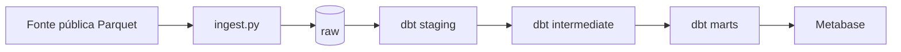

# TLC ELT — pipeline de dados de ponta a ponta

[](../../actions/workflows/ci.yml)

Pipeline ELT que ingere dados públicos de corridas de táxi de Nova York, transforma com
**dbt** e orquestra com **Airflow**, rodando inteiramente em Docker.

<!-- TODO: 1 parágrafo dizendo que pergunta o projeto responde, não o que ele usa. -->

## Rodando em 5 minutos

```bash
git clone <seu-repo>
cd tlc-elt
cp .env.example .env
docker compose up -d          # sobe Postgres + Airflow
docker compose logs airflow | grep -i password   # senha do Airflow em http://localhost:8080
make seed                      # baixa 3 meses e carrega em raw
make dbt                       # roda modelos e testes
```

## Arquitetura

<!-- TODO: diagrama (Mermaid) + uma frase por caixa -->



## Modelo de dados

| Camada | Schema | Materialização | Papel |
|---|---|---|---|
| raw | `raw` | tabela | cópia fiel da fonte |
| staging | `staging` | view | tipagem, limpeza, derivadas |
| intermediate | `intermediate` | view | joins e regras de negócio |
| marts | `marts` | tabela / incremental | dimensional pronto para consumo |

<!-- TODO: tabela dos modelos com grão e colunas-chave -->

## Resultados

<!-- TODO: os 3 gráficos + o número que cada um sustenta -->

## Decisões e trade-offs

<!-- TODO: 4 a 6 bullets. Exemplos:
- Por que Postgres e não Snowflake: custo zero, portabilidade do dbt.
- Por que incremental por mês: full refresh levava X min, incremental leva Y.
- Por que delete+insert e não merge: X.
- O que eu deixaria diferente em produção: orquestração, freshness, monitoramento. -->

## Qualidade de dados

<!-- TODO: lista dos testes e o que cada um protege. Inclua o teste de reconciliação. -->

## Limitações

<!-- TODO: seja honesto. Ex.: sem streaming, sem freshness automático, dados de 2024. -->

## Próximos passos

<!-- TODO: 2-3 itens concretos -->
