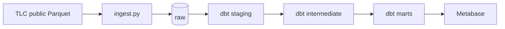

# TLC ELT — end-to-end data pipeline

[](../../actions/workflows/ci.yml)

New York City's yellow taxis make close to three million trips a month, and the city
publishes every one of them as a Parquet file. This project answers three questions an
operations team would ask about that data: **when and where demand concentrates**, **how
far and how fast trips really go per zone**, and **whether tipping changes with the payment
method**. It answers them end to end — Parquet into Postgres, layered models in dbt with
tests on every mart, and a monthly Airflow run that can be replayed without duplicating a
single row.

Everything runs in Docker: no cloud account, no paid warehouse. A clean clone needs two
commands.

## Running it in five minutes

```bash
git clone <your-repo>
cd tlc-elt
cp .env.example .env
make up      # Postgres + Airflow; also makes ./data writable for the container user
make seed    # downloads 3 months of Parquet and loads them into raw
make dbt     # runs the models and their tests
```

Airflow lives at **http://localhost:8080** (`admin` / `admin` locally — a real deployment
would take a managed password, never one baked into the compose file).
`make psql` opens the warehouse and `make down` stops the containers without dropping the
volume.

## Architecture



| Layer | Schema | Materialization | Role |
|---|---|---|---|
| raw | `raw` | table | verbatim copy of the source (`_source_file`, `_loaded_at`) |
| staging | `staging` | view | typing, cleaning, derived columns |
| intermediate | `intermediate` | view | joins and business rules |
| marts | `marts` | table / incremental | dimensional model ready for consumption |

<!-- TODO(semana 3): tabela dos modelos com grão e colunas-chave; números reais de linhas -->

## Results

<!-- TODO(semana 5): os 3 gráficos + o número que cada um sustenta -->

## Design decisions and trade-offs

<!-- TODO(semana 5): 4 a 6 bullets. Exemplos:
- Postgres instead of Snowflake: zero cost, and the dbt project stays portable by swapping the adapter.
- COPY instead of to_sql: 3M rows in ~50s against several minutes of row-by-row INSERT.
- delete+insert instead of merge: idempotency without depending on a stable key in the source.
- What I would do differently in production: source freshness, monitoring, dagster-style orchestration. -->

## Data quality

<!-- TODO(semana 2/3): lista dos testes e o que cada um protege. Inclua o teste de reconciliação. -->

## Limitations

<!-- TODO(semana 5): seja honesto. Ex.: no streaming, no automatic freshness check, data stops at 2024. -->

## Next steps

<!-- TODO(semana 5): 2-3 itens concretos -->
