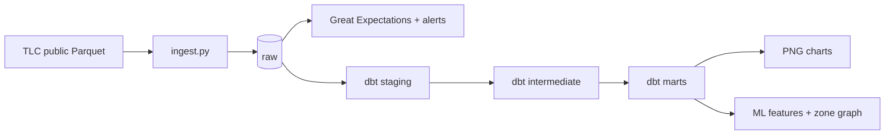
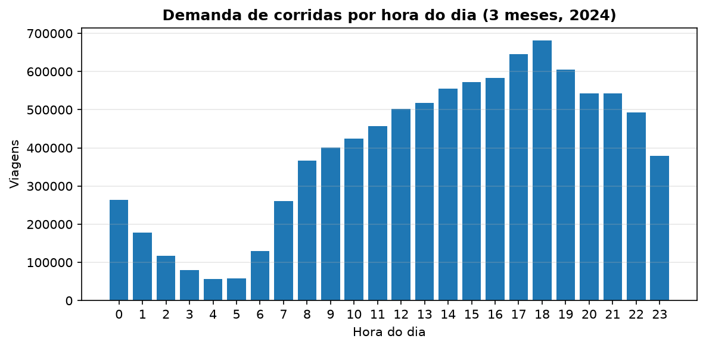
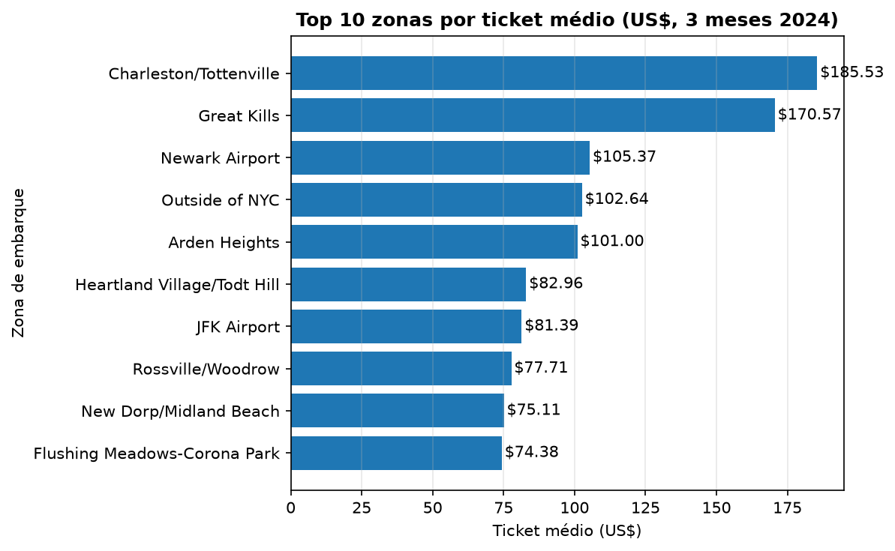
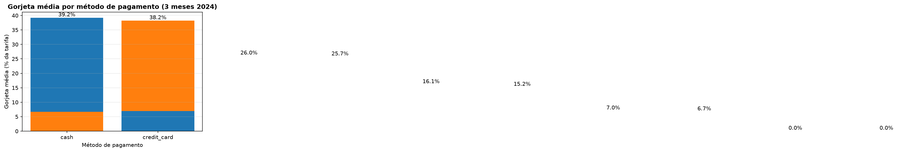

# TLC ELT — end-to-end data pipeline

[](../../actions/workflows/ci.yml)

New York City's yellow taxis make close to three million trips a month, and the city
publishes every one of them as a Parquet file. This project answers three questions an
operations team would ask about that data: **when and where demand concentrates**, **how
far and how fast trips really go per zone**, and **whether tipping changes with the payment
method**. It answers them end to end — Parquet into Postgres, layered models in dbt with
tests on every mart, and a monthly Airflow run that can be replayed without duplicating a
single row.

Everything runs in Docker: no cloud account, no paid warehouse. A clean clone needs three
`make` commands. The quality gate (Great Expectations) and the Dagster comparison are the only
pieces outside the compose file — each has its own pinned requirements file and venv.

## Running it in five minutes

```bash
git clone https://github.com/mrafalsk1/tlc-elt.git
cd tlc-elt
cp .env.example .env
make up      # Postgres + Airflow; also makes ./data writable for the container user
make seed    # downloads 3 months of Parquet + the zone lookup, loads them into raw
make dbt     # runs the models and their tests
```

Airflow lives at **http://localhost:8080** (`admin` / `admin` locally — a real deployment
would take a managed password, never one baked into the compose file).
`make psql` opens the warehouse and `make down` stops the containers without dropping the
volume.

The checks, including the two optional gates:

```bash
make validate       # check-env + ruff + pytest + dbt build, on an empty warehouse
make quality        # Great Expectations over the fixtures (needs .venv-quality)
make dagster-check  # Dagster definitions validate + asset list (needs .venv-dagster)
```

## Architecture



| Layer | Schema | Materialization | Role |
|---|---|---|---|
| raw | `raw` | table | verbatim copy of the source (`_source_file`, `_loaded_at`) |
| staging | `staging` | view | typing, sanity filters, dedupe, derived columns |
| intermediate | `intermediate` | view | zone names, business flags — no row is dropped |
| marts | `marts` | table / incremental | dimensional model ready for consumption |

### Data model

| Model | Grain | Key columns |
|---|---|---|
| `stg_yellow_trips` | one valid trip | 9.41M rows after filters and dedupe |
| `stg_taxi_zones` | one zone | 265 zones from the official TLC lookup |
| `int_trips_enriched` | one trip | 7 quality/business flags, zone names |
| `fct_trips` | one trip | `trip_id` = md5 of the natural key, incremental |
| `dim_zones` | one zone | borough, zone, `is_airport` |
| `agg_daily_demand` | day × pickup zone | trips, revenue, average ticket/duration/speed |
| `agg_payment_behavior` | payment method × tip bucket | trips, average tip rate, tips collected |
| `features_daily_zone` | day × pickup zone | 7-day rolling demand/revenue, previous-day demand, airport flag |
| `features_zone_graph` | one zone | PageRank, betweenness, in/out degree and weighted trip volume from the zone graph |

`zone_graph_features` is a committed seed (262 rows) generated by
`scripts/build_knowledge_graph.py`; the graph itself has 262 zones and 37,255 directed edges
weighted by 9,554,778 trips. Regenerate it with `python scripts/build_knowledge_graph.py`
followed by `dbt seed --select zone_graph_features`.

## Results

Three months of data (January–March 2024): **9,554,778 raw rows → 9,412,455 after
cleaning → 9,201,679 valid trips** (97.8%). The remaining 210,776 are kept in the fact
table and flagged, so every exclusion is auditable.

### Where the demand is

Midtown Center leads with 441,720 trips, followed by Upper East Side South (429,735) and
Upper East Side North (406,956). JFK Airport is fourth by volume (407,799) but first by
revenue: US$ 33.4M against US$ 10.8M from Midtown, because its average ticket is **US$
81.83** versus US$ 20–24 in Manhattan.



### When

The 6 p.m. hour carries 666,416 trips in the quarter, with 5 p.m. (632,051) and 7 p.m.
(591,465) right behind — the evening peak is three times the early morning.

### Tipping by payment method

Credit-card trips tip an average of **22.5% of the fare** (US$ 30.2M in the quarter).
Cash trips record **0.00%**. That is not a behavioural finding: the meter cannot see cash
tips. Read the number as *"tips are only observable for card payments"* — reporting it as
"cash riders are stingy" would be the classic mistake this dataset invites. Payment types
3–6 (no charge, dispute, unknown, voided) exist but are under 6% of the volume.





## Design decisions and trade-offs

- **Postgres instead of Snowflake.** Zero cost and the dbt project stays portable: the
  adapter is the only thing that changes.
- **`COPY ... FROM STDIN` instead of `to_sql`.** 3M rows load in ~50 seconds; row-by-row
  INSERT would take tens of minutes.
- **Idempotency by `delete+insert` on `_source_file` / `trip_id`.** The source has no trip
  ID, so the hash of the natural key is the only stable identity across reloads.
- **The intermediate model never filters.** Outliers become flags and only the
  aggregations filter them. This keeps `assert_revenue_reconciliation` an exact
  cross-layer check (staging revenue = fact revenue) instead of a comparison of two
  different populations.
- **dbt pinned to 1.8.2.** The upstream image resolves `dbt-core` to 2.0.0rc9, which has
  no Postgres adapter yet.
- **The intermediate model is a view, and that is where the time goes.** A single-month
  incremental run still takes ~110s because the dedupe window in staging/intermediate
  reads all 9.5M rows to rebuild the month. Materializing the intermediate (or pushing
  the month filter into staging) is the next performance step — measured, not assumed.

## Data quality

`dbt build` runs **58 nodes** (9 models + 1 seed + 44 generic tests + 4 singular tests), all
green — against an empty warehouse in CI and against the three months locally.

| Test | What it protects |
|---|---|
| `unique` + `not_null` on `fct_trips.trip_id` | no duplicated trip after reloads or backfills |
| `relationships` on both zone columns → `dim_zones` | no orphan zone in the fact table (verified: 0) |
| `accepted_values` on `payment_type`, `borough`, `payment_method` | a new code in the source fails the build instead of silently landing |
| `not_null` on `is_valid_trip`, `pickup_zone`, `dropoff_zone` | the flags and lookups are always populated |
| `assert_revenue_reconciliation` (singular) | staging revenue = fact revenue, tolerance zero |
| `assert_features_daily_zone_unique` (singular) | the `(zone_id, trip_date)` grain holds after any reload |
| `assert_features_*_non_negative` / `_ranges` (singular) | rolling and graph features stay in their documented ranges |

### Raw-data expectations (Great Expectations)

dbt tests protect the modeled layers; the source is checked before it becomes a model. A
separate suite — **11 expectations** built from the same rule definitions, 9 critical and 2
warnings — runs with Great Expectations 1.25 in its own venv (`.venv-quality`), so the main
`make validate` never pays for the dependency.

Run against January 2024 (2,964,624 rows, 8 seconds):

| Expectation | Violations |
|---|---|
| `fare_between` [0, 500] | **37,494** (37,448 negative, 46 above 500) |
| `dropoff_after_pickup` | **870** (814 zero-duration, 56 reversed) |
| `distance_between` [0, 200] mi | 31 |
| nulls, zone foreign keys, `payment_type` in 0–6 | 0 |

`tests/unit/test_quality_parity.py` runs the Pandas rules and the Great Expectations suite over
the same fixture and asserts they agree per expectation — it is what caught nullable zone IDs
being counted by one engine and ignored by the other.

### Idempotency, measured

The pipeline was replayed for the same three months: `ingest.py` deleted and reloaded each
file, and `dbt build --vars '{"month": ...}'` ran once per month. The counts did not move:

| Table | First run | Replay |
|---|---|---|
| `raw.yellow_trips` | 9,554,778 (3 files) | 9,554,778 (3 files) |
| `marts.fct_trips` | 9,412,455 | 9,412,455 |

`raw` replaces one month at a time by `_source_file`; `fct_trips` replaces it by `trip_id`
(delete+insert). After the replay, `trip_id` grouped with `having count(*) > 1` returned
zero rows, and each monthly `dbt build` finished green (43 nodes at the time — the project
has grown since).

### A failing test, on purpose

A quality gate is only real if bad data breaks the build. Inserting one trip with an
unknown `payment_type` into `raw` is enough:

```sql
insert into raw.yellow_trips
  (vendorid, tpep_pickup_datetime, tpep_dropoff_datetime, trip_distance,
   pulocationid, dolocationid, payment_type, fare_amount, total_amount,
   _source_file, _loaded_at)
values
  (1, '2024-01-01 08:00', '2024-01-01 08:20', 2.5,
   142, 236, 99, 12.5, 15.0, 'dirty_demo.parquet', now());
```

```
$ dbt test --select accepted_values_stg_yellow_trips_payment_type__0__1__2__3__4__5__6
1 of 1 START test accepted_values_stg_yellow_trips_payment_type__0__1__2__3__4__5__6  [RUN]
1 of 1 FAIL 1 accepted_values_stg_yellow_trips_payment_type__0__1__2__3__4__5__6  [FAIL 1 in 0.06s]
Done. PASS=0 WARN=0 ERROR=1 SKIP=0 TOTAL=1
```

Deleting the row (`_source_file = 'dirty_demo.parquet'`) restores the clean state. The demo
ran against a throwaway database, not the warehouse used for the results above.

## Operating the pipeline

The monthly DAG (`dags/elt_tlc.py`) runs three steps: `dbt source freshness` → `ingest_raw` →
`dbt build --vars month`. Everything is idempotent, so a replay is safe.

- **Retries:** 2 attempts with exponential backoff from 5 to 30 minutes — safe *because* ingest
  replaces one month by `_source_file` and `fct_trips` upserts by `trip_id`.
- **Timeouts:** 10/30/60 minutes per task and a 3-hour cap on the whole run. The cap is
  deliberately shorter than the theoretical worst case (345 minutes with every retry
  exhausted), so a stuck run cannot hold the monthly slot for days.
- **Alerting:** task failures and DagRun failures — including a run killed by the timeout —
  call `scripts/alerting.py`, which appends one JSON line to `data/alerts/alerts.jsonl` and,
  when `ALERT_WEBHOOK_URL` is set, posts it. Without the variable nothing breaks, so CI never
  needs a secret.
- **No Airflow SLA, on purpose:** `sla` is measured from `logical_date`, which for a monthly
  cron sits ~31 days before the run starts, so any useful SLA would fire on every run. The
  deadline is enforced by the timeouts instead (D-10 in `docs/DECISIONS.md`).
- **Runbook:** `docs/RUNBOOK.md` maps symptoms to diagnosis and action, including how to
  reprocess one month without duplicating a row.

## A second orchestrator (Dagster)

`dagster_project/` re-implements the first half of the pipeline as two assets — `raw_trips`
(Parquet) → `daily_agg` (DuckDB) — with a monthly schedule. It exists to compare models, not
to replace Airflow: `dagster definitions validate` and
`dagster asset materialize --select 'raw_trips+'` run in an optional CI job, and one
materialization writes 35 daily rows from 2,964,624 trips. The trade-off (task-first vs
asset-first, where the IO manager appears, when each model wins) is in D-12.

## Features for ML

Two models turn the marts into a modeling-ready shape:

- `features_daily_zone` — 20,338 rows (261 zones over the quarter) with 7-day rolling demand
  and revenue, previous-day demand and an airport flag. The grain is `(zone_id, trip_date)`,
  enforced by a singular test because the project does not use `dbt_utils`.
- `features_zone_graph` — one row per zone with PageRank (weighted by trips) and normalized
  betweenness: *where flow concentrates* versus *where flow must pass through*. It reads a
  committed seed generated from the raw Parquet by `scripts/build_knowledge_graph.py`
  (262 nodes, 37,255 edges, 9,554,778 trips, 2.7 s), so CI can test the join with no data.

## Infrastructure as code

`infra/terraform/` declares the same pipeline on AWS: an S3 bucket with versioning, encryption
and a TLS-only bucket policy for the raw layer; a private RDS Postgres 16 as the warehouse
(password created in Secrets Manager, no public endpoint); and a Glue catalog plus crawler over
the raw prefix, with a least-privilege IAM role for both. The module is **validated, not
applied** — `terraform fmt -check` and `terraform validate` run in CI, so nothing is created and
`docker compose` stays the path you can actually run. See `infra/terraform/README.md`.

## Limitations

- **No streaming.** The pipeline is batch; the `Kafka` extension is a separate project, not
  built here.
- **Freshness only warns.** `dbt source freshness` runs monthly, but the threshold is
  `warn_after: 45 day`, so a late month produces a warning, not a failed run.
- **Great Expectations is not in CI.** The suite runs on demand — `make quality` over the
  fixtures, or `run_quality.py --input data/raw/...` over a real batch — because it carries a
  heavy dependency; `make validate` stays lean.
- **Alerts are local.** JSONL file plus an optional webhook — no routing, escalation or
  deduplication, which is what PagerDuty-class tooling is for.
- **Cash tips are unobservable**, so any tipping metric covers card payments only.
- **2024 data only.** The Airflow DAG is monthly, but the seed loads three months.
- **Single-node Postgres.** 3 GB fact table; a warehouse would be the production answer.

## Next steps

- **Materialize the intermediate model (or push the month filter into staging).** A
  single-month incremental run still reads all 9.5M rows to rebuild the month; that is
  where the ~110s goes.
- **Promote freshness to `error_after`** once the publication lag of the source is measured,
  so a late month fails the run instead of warning.
- **Run the quality suite on the schedule**, writing results next to the alerts instead of
  only on demand.
- **Streaming project.** Producer replaying trips into a Kafka/Redpanda topic with Spark
  Structured Streaming, watermark and an idempotent upsert — specified separately.
- **Second, heterogeneous source.** The BCB SGS API (JSON, pagination, rate limits) to
  exercise a non-Parquet ingestion path.

## License

MIT — see [LICENSE](LICENSE).

