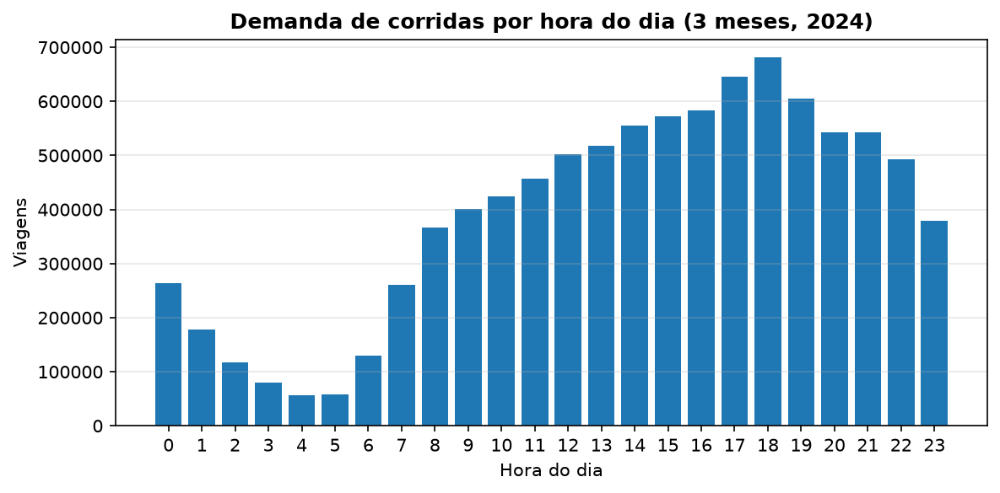
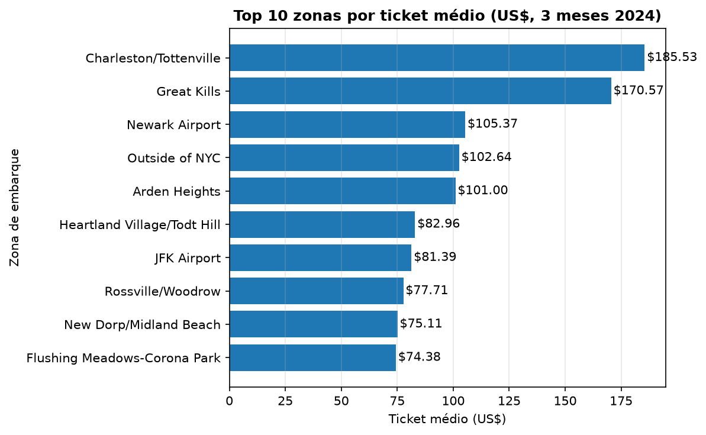
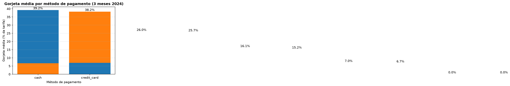

# TLC ELT — end-to-end data pipeline

[](../../actions/workflows/ci.yml)

New York City's yellow taxis make close to three million trips a month, and the city
publishes every one of them as a Parquet file. This project answers three questions an
operations team would ask about that data: **when and where demand concentrates**, **how
far and how fast trips really go per zone**, and **whether tipping changes with the payment
method**. It answers them end to end — Parquet into Postgres, layered models in dbt with
tests on every mart, and a monthly Airflow run that can be replayed without duplicating a
single row.

Everything runs in Docker: no cloud account, no paid warehouse. A clean clone needs two
commands.

## Running it in five minutes

```bash
git clone <your-repo>
cd tlc-elt
cp .env.example .env
make up      # Postgres + Airflow; also makes ./data writable for the container user
make seed    # downloads 3 months of Parquet + the zone lookup, loads them into raw
make dbt     # runs the models and their tests
```

Airflow lives at **http://localhost:8080** (`admin` / `admin` locally — a real deployment
would take a managed password, never one baked into the compose file).
`make psql` opens the warehouse and `make down` stops the containers without dropping the
volume.

## Architecture


| Layer | Schema | Materialization | Role |
|---|---|---|---|
| raw | `raw` | table | verbatim copy of the source (`_source_file`, `_loaded_at`) |
| staging | `staging` | view | typing, sanity filters, dedupe, derived columns |
| intermediate | `intermediate` | view | zone names, business flags — no row is dropped |
| marts | `marts` | table / incremental | dimensional model ready for consumption |

### Data model

| Model | Grain | Key columns |
|---|---|---|
| `stg_yellow_trips` | one valid trip | 9.41M rows after filters and dedupe |
| `stg_taxi_zones` | one zone | 265 zones from the official TLC lookup |
| `int_trips_enriched` | one trip | 7 quality/business flags, zone names |
| `fct_trips` | one trip | `trip_id` = md5 of the natural key, incremental |
| `dim_zones` | one zone | borough, zone, `is_airport` |
| `agg_daily_demand` | day × pickup zone | trips, revenue, average ticket/duration/speed |
| `agg_payment_behavior` | payment method × tip bucket | trips, average tip rate, tips collected |

## Results

Three months of data (January–March 2024): **9,554,778 raw rows → 9,412,455 after
cleaning → 9,201,679 valid trips** (97.8%). The remaining 210,776 are kept in the fact
table and flagged, so every exclusion is auditable.

### Where the demand is

Midtown Center leads with 441,720 trips, followed by Upper East Side South (429,735) and
Upper East Side North (406,956). JFK Airport is fourth by volume (407,799) but first by
revenue: US$ 33.4M against US$ 10.8M from Midtown, because its average ticket is **US$
81.83** versus US$ 20–24 in Manhattan.



### When

The 6 p.m. hour carries 666,416 trips in the quarter, with 5 p.m. (632,051) and 7 p.m.
(591,465) right behind — the evening peak is three times the early morning.

### Tipping by payment method

Credit-card trips tip an average of **22.5% of the fare** (US$ 30.2M in the quarter).
Cash trips record **0.00%**. That is not a behavioural finding: the meter cannot see cash
tips. Read the number as *"tips are only observable for card payments"* — reporting it as
"cash riders are stingy" would be the classic mistake this dataset invites. Payment types
3–6 (no charge, dispute, unknown, voided) exist but are under 6% of the volume.





## Design decisions and trade-offs

- **Postgres instead of Snowflake.** Zero cost and the dbt project stays portable: the
  adapter is the only thing that changes.
- **`COPY ... FROM STDIN` instead of `to_sql`.** 3M rows load in ~50 seconds; row-by-row
  INSERT would take tens of minutes.
- **Idempotency by `delete+insert` on `_source_file` / `trip_id`.** The source has no trip
  ID, so the hash of the natural key is the only stable identity across reloads.
- **The intermediate model never filters.** Outliers become flags and only the
  aggregations filter them. This keeps `assert_revenue_reconciliation` an exact
  cross-layer check (staging revenue = fact revenue) instead of a comparison of two
  different populations.
- **dbt pinned to 1.8.2.** The upstream image resolves `dbt-core` to 2.0.0rc9, which has
  no Postgres adapter yet.
- **The intermediate model is a view, and that is where the time goes.** A single-month
  incremental run still takes ~110s because the dedupe window in staging/intermediate
  reads all 9.5M rows to rebuild the month. Materializing the intermediate (or pushing
  the month filter into staging) is the next performance step — measured, not assumed.

## Data quality

`dbt build` runs **43 nodes** (6 models + 36 tests + 1 singular test), all green.

| Test | What it protects |
|---|---|
| `unique` + `not_null` on `fct_trips.trip_id` | no duplicated trip after reloads or backfills |
| `relationships` on both zone columns → `dim_zones` | no orphan zone in the fact table (verified: 0) |
| `accepted_values` on `payment_type`, `borough`, `payment_method` | a new code in the source fails the build instead of silently landing |
| `not_null` on `is_valid_trip`, `pickup_zone`, `dropoff_zone` | the flags and lookups are always populated |
| `assert_revenue_reconciliation` (singular) | staging revenue = fact revenue, tolerance zero |

## Limitations

- **No streaming.** The pipeline is batch; the `Kafka` extension is documented but not built.
- **No automatic freshness check.** `source freshness` is declared but not scheduled.
- **Cash tips are unobservable**, so any tipping metric covers card payments only.
- **2024 data only.** The Airflow DAG is monthly, but the seed loads three months.
- **Single-node Postgres.** 3 GB fact table; a warehouse would be the production answer.

